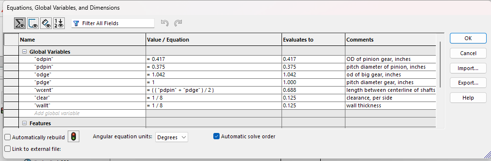

# A8 – Gearbox and Shaft Design

## Objective
Using the appropriate equations, determine whether the provided shaft dimensions are adequate to transmit the requireed output torque. Additionally, determine the size of an appropriate bearing, then construct a housing for the entire assembly.

## Calculations

### Shaft Analysis
Before bearing calculations can begin, the shafts must be determined whether or not they are adequate for this application. The system needs to output 1.25 in-lbf and operate at 1100 rpm at output. The gear ratio is 24:9 Output:Input, the input shaft has a diameter of 0.125in and the output shaft 0.25in, both with a length of 1 in.

Since the output RPM and torque was given, the input torque and RPM had to be calculated using the gear ratios. From this, the initial formulas and calculations are outlined.
For the initial calculations, there were conflicting results between expected power and torque and the calculated power and torque. Upon reviewing the results, those calculations were for the maximum power the shaft could transmit, not the actual loading scenario. 

Repeating the calculations, the maximum torsional stress was determined. For both the input and output shaft, the calculated stress was lower than the expected values for each type of shaft. In conducting the calculations, I determined that the input and output shafts both have the same amount of power transmission. 

### Bearing Analysis and Gearbox Sketch

To simplify the calculations for the bearings, some assumptions were made. There was no assumed radial force and the gear train is ideal. 

For the input shaft, the maximum pressure was 40 psi, the surface velocity is 96 fpm, and the PV is 3840. 

For the output shaft, the pressure is 20 psi, V is 72 fpm, and the PV is 1440. Since the values for the input shaft are higher than those of the output shaft, those values will be selected for bearing selection.
Graphite was selected as the material for the bearing, as it is rated for 600 psi, 2500 fpm, and PV of 15000. 

For the bearings, an assumed combined length of 0.5 inches was used, and the shaft is to be supported on both ends. 
Cross referencing the McMaster Carr directory, bearing 9368T96 is to be used for the input shaft, and 9368T11 for the output shaft.

A rough sketch and parametric calculations for the gearbox are shown.

## Modelling the Gearbox

### Gearbox Body

A rough sketch, similar to the paper one, was constructed.

Equations were defined

 Do note, in this screen shot the wall thickness is defined as 1/8", but the final wall width is 1/4" to accomadate the width of the bearings.

 

The sketch is defined using the vairables and approriate relations.

The sketch is then extruded 1.00 in to accomodate the shaft length.

The part is then "shelled" using the wall width variable.

Now, a new sketch is started to create holes for the bearings. Initially, the holes were dimensioned for the shaft diameter.

However,, upon further review, this was corrected to account for the bearing outer diameter and interference fit, as defined by the McMaster Carr data sheets.

The holes were then cut through the surface of the gear box.

### Gearbox Lid

To start, the equations defined in the previous part were imported into this second part to streamline the process. 

After this, the sketch was defined using the variables.

The sketch was then extruded to the wall thickness.

The final seperate parts.

## Drawings

Drawings for each shaft, each bearing, each half of the gearbox, and the whole assembly were created.
All parts were toleranced for their appropriate fits.

Input shaft

Output Shaft

Input bearing

Output Bearing

Gearbox Housing

Gearbox Lid

Final Assembly

## Closing thoughts

I learned to use the given equations appropriately, not just blindly plugging in variables to find a solution. I know that the shaft need to be longer than 1 in to accomodate power transmission in the real world. Additionally, The final design does not include bolt holes, and the lid does not quite interface with the body of the gearbox correctly. Learning about bearing and their caclulations has been fascinating, but I know it just scratches the surface.

Overall, this project took around 14 hours to complete. 

