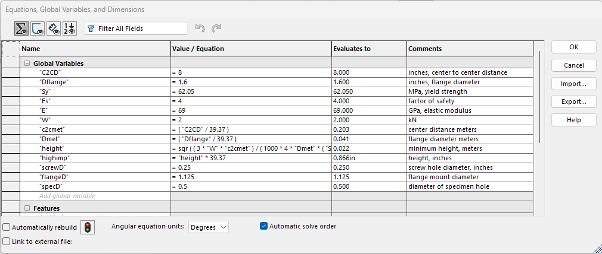
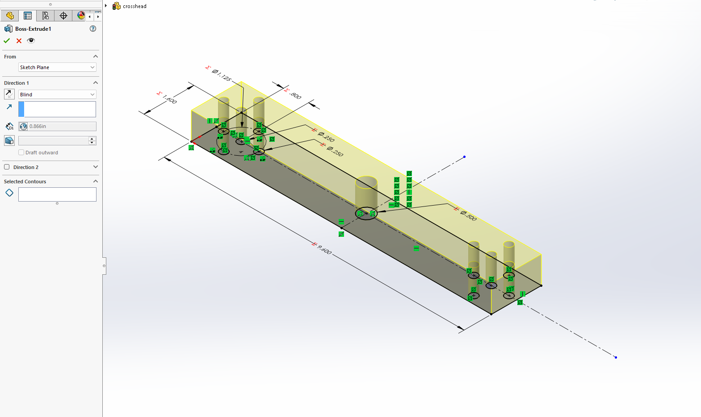

# A10 – Lead Screw Tensile Tester

## Crosshead Design - Aidan Cadle

In building the tensile tester, the crosshead had to be designed with a factor of safety of 4, a maximum deflection of 0.1 mm, and support a tensile load of 2 kN. Given the constraints and example of "low cost" testers, the chosen material is 6061-O Aluminum, and the center to center distance between the two lead screw holes is 8 in. 
6061-O Aluminum has a yield strength of 62.05 MPa, and an elastic modulus E = 69 GPa.

Initially, the calculations assumed a square cross sectional area. However, this would lead the flange to "stick out" from the crosshead and mount incorrectly, so the calculations were repeated using a rectangular cross sectional area. 

Calculations were repeated, but now the width of the crosshead was set to 1.6 in, the outer diameter of the flange. Using the equations for a fixed beam with a load in the center, calculating for both stress and strain, the minimum height of the crosshead was determined to be 0.866 in. 

Under the calculations, the rough multi angle sketch, with a top, front, and right view is included. While not specifically labeled, the material of the crosshead is 6061-O Aluminum, as described above. 
Holes are included for the lead screws, flange mounting, and specimen mounting solution. 

## Parametric Modelling

### Crosshead - Aidan Cadle

For the 3D model, the part was parametrically calculated.
Variables and equations were defined for every useful value needed within the calculations.

After all of the variables, equations, and metric to imperial conversions were applied, the result matched that of the previously calculated value.

Now, the sketch can be defined using these variables and calculated values.

The sketch was then extruded out using parametric techniques.

The final part, parametrically produced. 

## FEA - Aidan Cadle

### Initial Part

For the FEA, some assumptions were made about the configuration.

The mounting holes for the flange were treated as fixed geometry.

The tensile load was treated as acting down through the specimen mounting hole.

The test was run three times, with the mesh density increasing each time.

For the first run, the mesh was coarse.

The results for the first run.

Peak stress is 35MN.

Peak displacement is 0.03 mm.

The minimum factor of safety is 1.763.

The mesh size was then increased to medium, between coarse and fine

Rerunning the study, the displacement converged within 10%, but the factor of safety and peak stress did not.

Peak displacement is 0.03124 mm.

Peak stress is 42.5 MN

The minimum factor of safety is 1.461

Since the results did not converge within 10%, the part was re-analyzed. 

The mesh density was increased to fine.

On this run, the values almost converged within 10%, but did not.

Peak stress is 47.1 MN.

Peak displacement is 0.03129 mm.

The minimum factor of safety is 1.317.

Since the peak stress and resulting factor of safety are not within the allowable range, some changes will be made to improve the characteristics of the crossbar.

The maximum stress occured at the inner most mounting hole for the flange, in the direction of the center of the beam. The hole for the specimen gripper also had elevated stress, but that moved out towards the side of the beam. 
Peak deflection always occured in the middle of the beam near the load. 

The initial mass is 1.24 lbs.

### Modifications

Fillets will be added to the holes to reduce the stress concentration, with a radius of 1/8 in on all edges.
Additionally, a boss will be added for the flange to increase rigidity, with a thickness of 1/4 in.
Since the initial stress was much higher than expected, the height of the beam was doubled compared to the original calculated value.

Modified beam

Similar to the first round of FEA, the mesh started at coarse.

The peak stress is 9 MN.

The peak displacement is 0.00578 mm.

The minimum factor of safety is 6.84

The mesh was then increased to medium

The peak stress is 11.5 MN

The peak displacement is 0.005813

The minimum factor of safety is 5.398

Since these values do not converge, a final run using the fine mesh will be conducted.

The peak stress is 12.3 MN

The peak displacement is 0.00582 mm

The minimum factor of safety is 5.039.

These values converge within 10%, so the values calculated using the fine mesh will be used. 

Despite the changes, the general locations of the peak stress and displacement did not change.
The modified part is within the given specifications.

There were no notable changes in stress or displacement patterns. 

The final mass is 2.56 lbs. 

